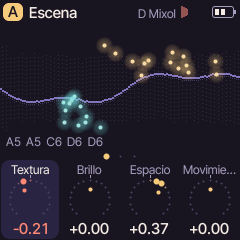
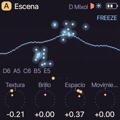
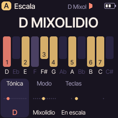

# amb-iguos

Firmware ambient y granular para el **M-VAVE FM-1**. Está pensado para paisajes sonoros, texturas de cine y música que evoluciona sola.

  

> **Estado: 0.1, sin probar todavía en una FM-1 real.** El motor, los efectos, la Deriva y las pantallas se prueban en el ordenador (`tests/run_tests.sh`). El paquete se compila en GitHub Actions. Instálalo bajo tu responsabilidad y ten a mano el camino de vuelta (abajo).

Está basado en [Mini-Grain](https://github.com/eldontyrellcorp/Mini-Grain) (GPL-3.0). De él vienen el motor granular, los generadores y la plataforma de Felucca / Mini-Tone de Leo Kuroshita. Lo nuevo de amb-iguos:

- **Una interfaz nueva.** Cada pantalla tiene una imagen grande y viva arriba y solo 4 diales abajo, que son justo los que mueven K1 a K4. Cada botón hace lo que dice su nombre, en todas las pantallas.
- **Escala.** Eliges tónica y modo: mayor, menor, dórico, frigio, lidio, mixolidio, locrio, menor armónica, pentatónicas, hirajoshi y tonos enteros. Las teclas pueden quedar "en escala".
- **Deriva.** Un generador que toca solo dentro de la escala: notas y acordes que pasean, un drone en la tónica (y la quinta) y parámetros del grano que evolucionan despacio.
- **Freeze.** Congela lo que suena: las notas, la posición de los granos y una cola de reverb larga.
- **Reverb con shimmer** (+12, +7, +19 o −12 semitonos), dentro de la realimentación de la reverb.
- **Cuatro macros** en la pantalla principal: Textura, Brillo, Espacio y Movimiento.
- **Generadores de cine:** Braam, Swell (crecida en reverso), Tensión (clúster con trémolo), Impacto y Shepard (subida infinita). Además, el patrón "Escala" en Pulsado y FM.
- **Batería** siempre visible arriba a la derecha (o "USB" con el cable conectado).
- **Tres capas:** **A** y **B** son granulares y **D** es el drone de Mini-Grain. Se quitan el pad y el secuenciador por pasos.

Funciona en las FM-1 con el chip de memoria nuevo (UC25HQ80, las del logo bajo la pantalla) y en las antiguas.

## Los controles

| Control | Qué hace |
|---|---|
| **HOME** | ESCENA: la nube de sonido y las 4 macros. Si lo pulsas otra vez, páginas de grano (u oscilador en el drone). |
| **EDIT** | FUENTE: el sonido de la capa (un generador o una muestra tuya). Se rehace solo al dejar de girar. |
| **SCL** | ESCALA: tónica, modo y teclas en escala. |
| **ENV** | VOZ: ataque, release, transposición, nivel, mantener, canal MIDI. |
| **LFO** | MOVIMIENTO: filtro, LFO 1 y LFO 2. |
| **FX** | ESPACIO: reverb, shimmer y delay. |
| **SEQ** | Ajustes de la DERIVA: ritmo, densidad, duración, acorde, octava, rango, capas, drone y evolución. |
| **GLO** | SISTEMA: batería, CPU, canales MIDI, versión. |
| **SAVE** | PRESETS. Dentro de PRESETS, SAVE guarda en la ranura (pulsa dos veces si ya está ocupada). K2 a la derecha carga. |
| **PLAY** | Arranca o para la Deriva (el LED se enciende). |
| **REC** | Freeze sí / no (el LED se enciende). |
| **ARP** | Mantener las notas de la capa: tocas un acorde, sueltas y sigue sonando. |
| **K1–K4** | Los cuatro diales de la pantalla. |
| **SELECT** | Página dentro de la sección. Pulsar otra vez el botón de la sección hace lo mismo. |
| **ALGORITHM** | Capa A, B o D (drone). |
| **PRESETS** | Elige ranura (abre PRESETS). |
| **OCT− / OCT+** | Octava del teclado. Los dos juntos 5 s: modo actualización. |
| **MASTER** | Volumen. |

Un punto blanco dentro de un dial indica dónde lo ha llevado ahora mismo un LFO, una macro o la Deriva.

## Instalar

**Lo más fácil: el instalador web** → **https://thephonus.github.io/amb-iguos/**

Ábrelo en Chrome o Edge, conecta la FM-1 por USB y pulsa **Instalar**. Instala siempre la última versión compilada. Desde esa misma página puedes volver al firmware oficial con el `FM-1.fwsc` de la **V15**. Desde amb-iguos (y desde otros firmwares hechos sobre Felucca) la FM-1 rechaza la V16 sin escribir nada. M-VAVE ya solo ofrece la V16, pero [FM1 Unbricker](https://quixotic7.github.io/MvaveFM1Unbricker/) guarda una copia de la V15. Ya en la V15 oficial, puedes subir a la V16 con M-UPGRADE.

Si tienes otro firmware no oficial (JIANT, SLOOP, Felucca…), vuelve antes al oficial. Desde el oficial, desde Mini-Grain o desde otra versión de amb-iguos puedes instalar directamente.

**Con Python, sin navegador:** descarga `amb-iguos.fwsc` (pestaña Actions → la ejecución más reciente → artefacto **amb-iguos-fwsc**) y ejecuta `python3 tools/fm1_install.py amb-iguos.fwsc` (necesita `pip install mido python-rtmidi`).

Si se queda en negro: [FM1 Unbricker](https://quixotic7.github.io/MvaveFM1Unbricker/). La identidad del paquete es `FM-1_946`.

## Muestras propias

Abre **https://thephonus.github.io/amb-iguos/muestras/** (o `web/index.html`) en Chrome o Edge con la FM-1 conectada y arrastra tus audios: caben 7 muestras de hasta ~2 s a 22 kHz. En la FM-1 aparecen en FUENTE (EDIT): gira K1 más allá de los generadores.

## Compilar

Mira [BUILDING.md](BUILDING.md). En resumen: `tools/get_toolchain.sh`, el SDK AC79 de JieLi y `./build.sh`. Las pruebas en el ordenador (`tests/run_tests.sh`) solo necesitan `cc`, `python3`, `numpy` y `Pillow`. Las capturas de pantalla salen en `build/ui/` y una escena de audio de 70 s en `build/drift.wav`.

## Licencia

GPL-3.0-only, como Mini-Grain y Felucca. Mira [LICENSING.md](LICENSING.md). La documentación original de Mini-Grain está en [README-mini-grain.md](README-mini-grain.md).
